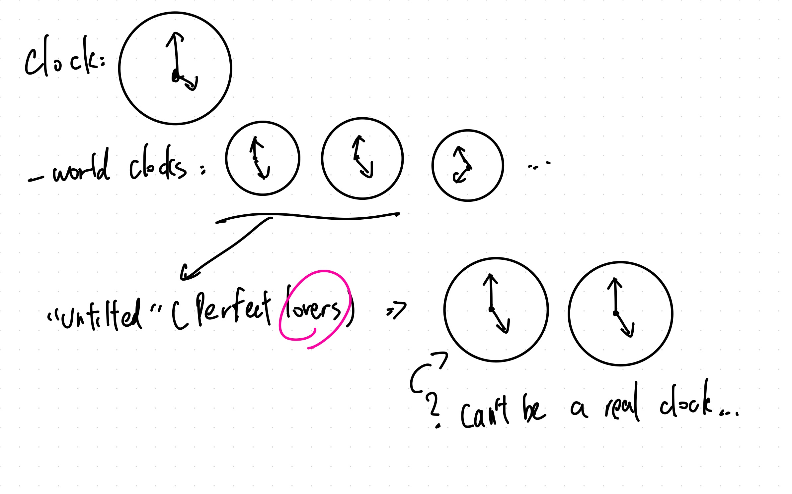
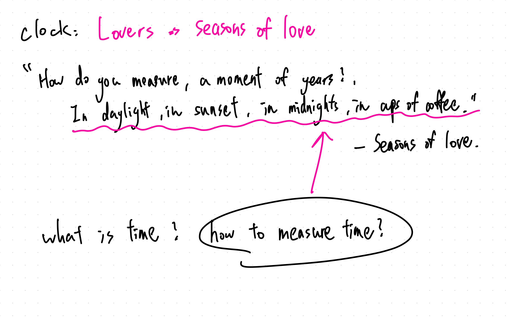
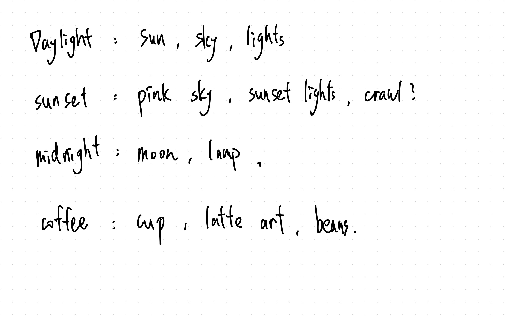
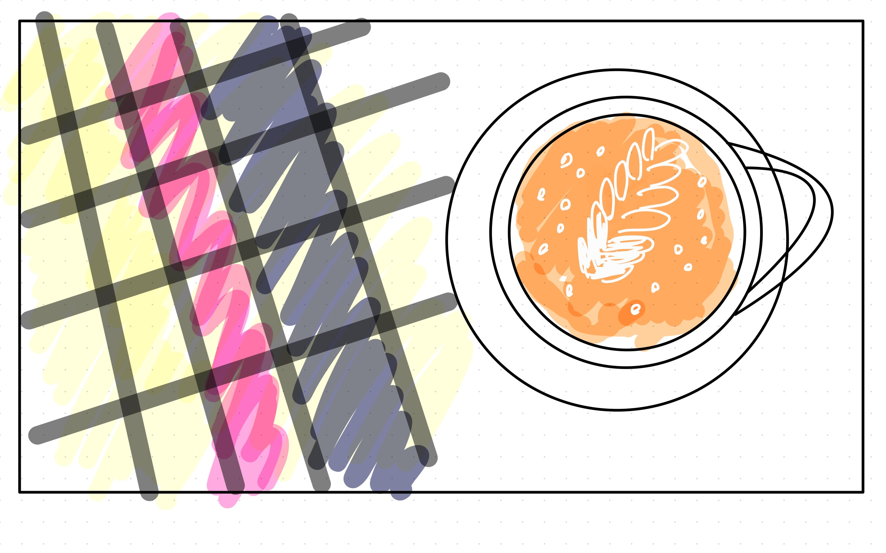
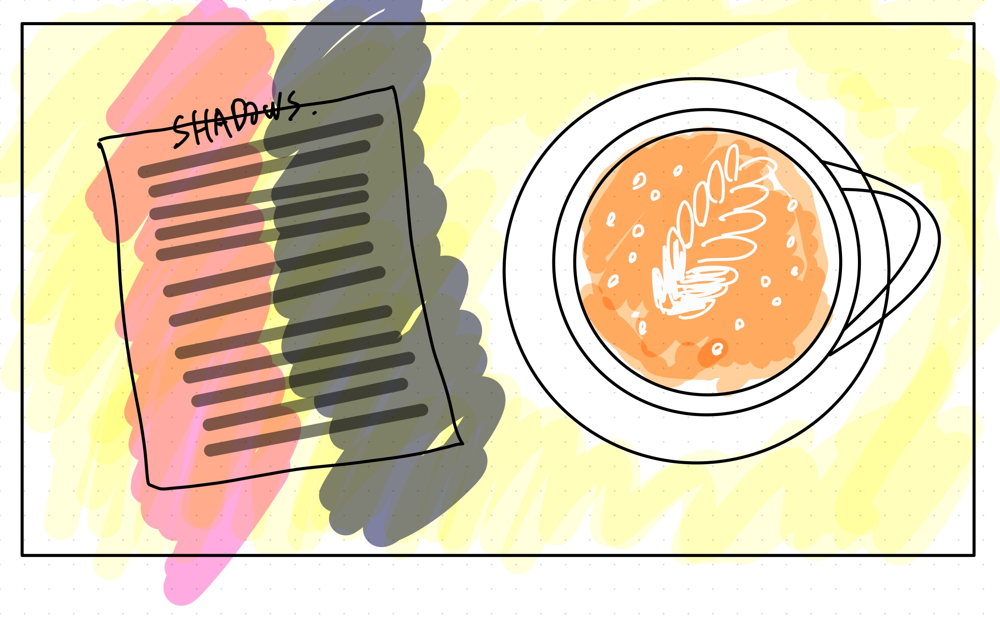

# Week 6

## Process

When I first saw this assignment, I kept thinking about how to make a clock that could clearly show time. Basically, all the ideas in my head were still about traditional clocks. Since my girlfriend and I are in a long-distance relationship, we often ask each other what time it is. This made me think about world clocks, where several clocks show the time in different places.

Last weekend, I visited the Whitney Museum and saw a work by Félix González-Torres. After I got home, I looked up more of his works and found _“Untitled” (Perfect Lovers)_. The artwork has two clocks set to the same time, representing two lovers who start together but may slowly become out of sync as time passes. I thought this was really interesting, and my first reaction was that it was very related to this assignment.

But after thinking about it more, I realized that I couldn't just draw two actual clocks. One reason was that it would be kind of boring, and another was that it was too direct and didn't really fit the assignment. So I started thinking about other ideas. The word "lovers" suddenly reminded me of _Seasons of Love_, a song from the musical _Rent_. I especially liked the part about measuring a year through daylight, sunsets, midnights, and cups of coffee. I thought it was a really nice way to show time passing through everyday things instead of just numbers. So I decided to start from this idea.

Before sketching, I listed some things related to the lyrics, like sunlight, the sky, lighting, coffee cups, and latte art. I then realized that most of these things, except coffee, could be represented by changes in light and shadow. So I decided to combine coffee and lighting as the main elements of my clock.

I drew my first sketch with a coffee cup viewed from above and shadows falling across the table. After that, I started coding the coffee cup, latte art, and seconds first. The basic drawing part went pretty smoothly, but calculating the positions, angles, and sizes of the leaves gave me a headache. I ended up working with AI on a lot of the math, although sometimes it was even worse at calculating than me, so I still had to spend quite a lot of time testing and fixing things.

Originally, I wanted to use shadows falling directly on the table to represent hours. But after I coded it, the result didn't look as good as I imagined. The shadows were not very clear, and I couldn't really feel the change of time through them. So I went back and made another sketch, this time adding a piece of paper next to the coffee cup, almost like a café menu, with 12 shadows falling across it. After coding this version, I felt that the hours became easier to notice, and the whole composition looked better too.

For the coffee, I used latte art to represent minutes. Each leaf represents one minute, with the leaves appearing alternately on the left and right to form a Rosetta pattern. For seconds, I used small bubbles around the edge of the coffee, so the time changes could become part of the coffee itself.

Besides the math problems, I also had some difficulties while coding. Sometimes the code worked without any errors, but the result looked completely different from what I had imagined, especially with the latte art and shadows. I spent a lot of time changing the size, spacing, and position of the leaves to make the pattern look more natural. Another problem came when I tried to make the project fill the browser window. The original fixed size left empty spaces on the sides, but extending the background also caused problems with the gradient colors. I had to keep adjusting the background and resolution to make everything look right.

## Reflection

I think the biggest challenge of this project was finding a balance between making time readable and keeping the visual design interesting. At first, I spent a lot of time thinking about how each element could clearly represent hours, minutes, and seconds. But some of the ideas ended up looking too much like a regular clock, or just didn't look very natural in the composition.

I also realized that something can look good in a sketch but not necessarily work well when translated into code. For example, I originally thought the shadows on the table would be pretty easy to make, but it was actually difficult to make them look natural while still showing the hours clearly. The same thing happened with the latte art. Even a small change in the number, spacing, or angle of the leaves could make the whole pattern look very different.

This project also made me more comfortable with changing my ideas while coding. Instead of deciding everything at the beginning, I found myself testing things, looking at the results, and then going back to change the design. I think that process helped me slowly find a version that I liked.

In the end, I also started to feel that the clock didn't really need to show the exact time in a way that everyone could immediately understand. The light changes, the latte art slowly grows, and the coffee surface changes over time. These things might not be as clear as a traditional clock, but I think they are closer to the idea of _Seasons of Love_, which is about measuring time through small moments in everyday life instead of just counting it.
